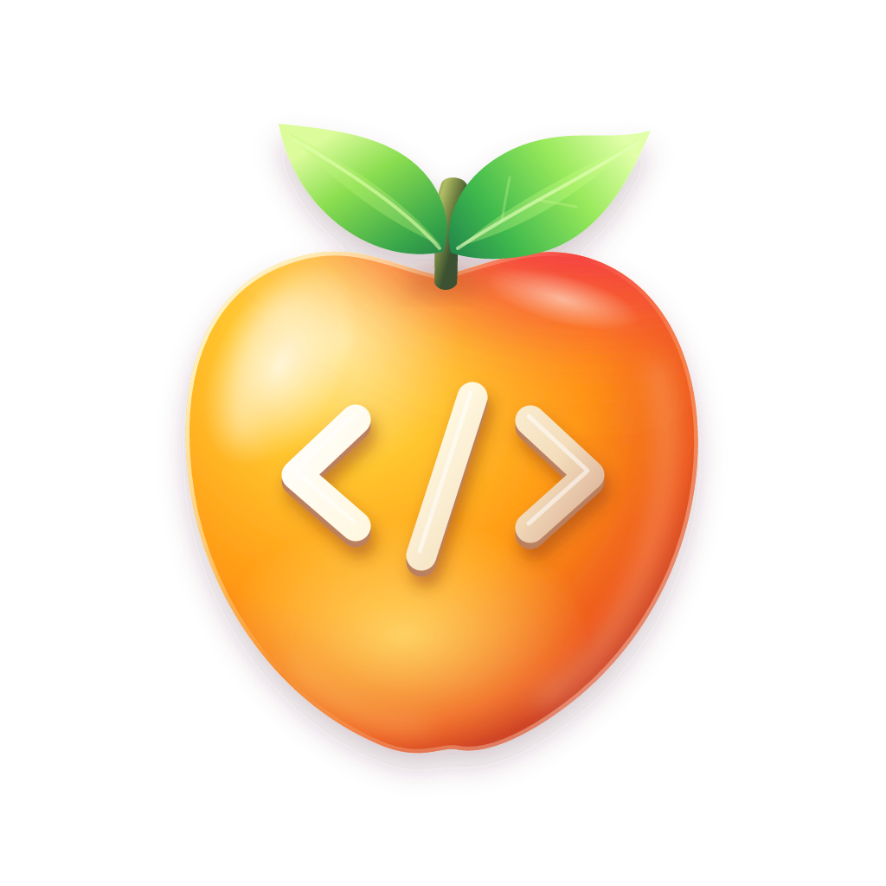

# Wumpa

<p align="center">
  
</p>

Manage projects, Git worktrees, and persistent coding-agent sessions on a remote
server from your terminal. Open checkouts in Zed without juggling SSH sessions.

- 🖥️ Manage remote projects from your terminal.
- 🌿 Access Git worktrees.
- 🤖 Keep coding-agent sessions running and reconnect anytime.
- ⚡ Open remote checkouts in Zed.
- 🔐 Connect through SSH.

## Quick start

1. With [mise](https://mise.jdx.dev/getting-started.html) installed and activated,
   install Wumpa on your computer and Linux server:
   ```sh
   mise use -g github:lucaconlaq/wumpa@latest
   ```
   Prebuilt binaries are available for macOS and Linux on x86_64 and ARM64;
   no Rust toolchain is required.
2. Need a server? See [TNT](tnt/README.md) to provision a Wumpa server on
   Google Cloud with NixOS. If you already have a Linux server, start Wumpa there:
   ```sh
   mkdir -p "$HOME/.wumpa/run"
   chmod 700 "$HOME/.wumpa/run"
   wumpa serve --socket "$HOME/.wumpa/run/control.sock" --detach
   ```
3. Run `wumpa` on your computer. Press `n` to add your server's SSH alias or
   `user@host` (default port: `7432`), then Enter to connect. Use the on-screen
   shortcuts to manage repositories, worktrees, and agents; press `z` to open a
   checkout in Zed. Press Enter on a checkout to open SSH, or on an agent to attach.
